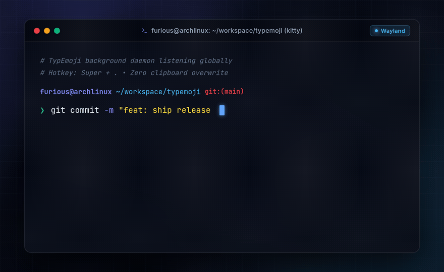

# TypEmoji

<h3 align="center">
  A native Windows-style emoji and symbol picker for Linux that types directly into any active application with <code>Super + .</code> without overwriting your clipboard.
</h3>

<p align="center">
  <a href="https://typemoji.netlify.app"><strong>🎮 Try the Live Web Simulator</strong></a> •
  <a href="#quick-install"><strong>⚡ Quick Install</strong></a> •
  <a href="https://github.com/Ayan-Jain-737/TypEmoji/releases/latest"><strong>📦 Releases</strong></a> •
  <a href="https://github.com/Ayan-Jain-737/TypEmoji/discussions"><strong>💬 Discussions</strong></a>
</p>

<p align="center">
  
</p>

<p align="center">
  <a href="https://github.com/Ayan-Jain-737/TypEmoji/actions/workflows/ci.yml"></a>
  <a href="https://github.com/Ayan-Jain-737/TypEmoji/releases/latest"></a>
  
  
  <a href="https://github.com/Ayan-Jain-737/TypEmoji/issues?q=is%3Aissue+is%3Aopen+label%3A%22good+first+issue%22"></a>
  <a href="https://github.com/Ayan-Jain-737/TypEmoji/discussions"></a>
  <a href="LICENSE"></a>
</p>

---

## Quick Install

Install in one command (auto-detects distribution and installs native package or portable binary):

```bash
curl -fsSL https://raw.githubusercontent.com/Ayan-Jain-737/TypEmoji/main/install.sh | bash
```

### Distro Packages

| Distribution | One-Command Install |
| :--- | :--- |
| **Arch Linux / Manjaro** | `sudo pacman -U https://github.com/Ayan-Jain-737/TypEmoji/releases/latest/download/TypEmoji-2.3.1-Arch-Linux-x86_64.pkg.tar.zst` |
| **Ubuntu / Debian / Mint** | `sudo apt install ./TypEmoji-2.3.1-Ubuntu-Debian-x86_64.deb` *(or via installer above)* |
| **Fedora / RHEL** | `sudo dnf install https://github.com/Ayan-Jain-737/TypEmoji/releases/latest/download/TypEmoji-2.3.1-Fedora-openSUSE-x86_64.rpm` |
| **openSUSE** | `sudo zypper install https://github.com/Ayan-Jain-737/TypEmoji/releases/latest/download/TypEmoji-2.3.1-Fedora-openSUSE-x86_64.rpm` |
| **Universal Linux (.run)** | `chmod +x TypEmoji-2.3.1-Universal-Installer.run && ./TypEmoji-2.3.1-Universal-Installer.run` |

All precompiled packages and standalone tarballs are available on the **[Releases Page](https://github.com/Ayan-Jain-737/TypEmoji/releases/latest)**.

---

## 🎮 Live Web Demo

Try the interactive UI before installing anything on your system:  
👉 **[Open the TypEmoji Web Simulator](https://ayan-jain-737.github.io/TypEmoji/)**

- Test instant keyword search across 3,900+ Unicode 16.0 emojis
- Browse curated Kaomoji (`(づ｡◕‿‿◕｡)づ`, `(╯°□°)╯︵ ┻━┻`) and typographic math symbols
- Try the interactive 6-tone Fitzpatrick skin selector

---

## Why TypEmoji?

On Windows, `Win + .` gives you an instant emoji and symbol picker that types into whichever window is active. On Linux, native emoji input is historically broken across different toolkits: GNOME has an emoji popup inside native GTK entries (but it doesn't work in browsers, Electron apps, terminals, or VS Code), while command-line clipboards overwrite your copy-paste buffer.

TypEmoji gives you the missing native experience:
1. **Global Shortcut**: Press `Super + .` (or click the tray icon) anywhere.
2. **Instant Search**: Type immediately to fuzzy-filter names, categories, and keywords.
3. **Zero Clipboard Overwrite**: Types characters into the target application while cleanly preserving whatever was in your system clipboard.
4. **Wayland & X11 Native**: Built with C++23 and Qt 6. Supports KDE Plasma 6, GNOME 44+, Sway, Hyprland, XFCE, Cinnamon, and i3.

---

## ✨ Features & What's New in v2.3.1

- 📌 **Multi-Emoji Continuous Typing & Pin Mode (v2.3.1)**:
  - **Seamless Multi-Emoji Typing**: Hold `Shift` while clicking or pressing `Enter` (`Shift + Click` or `Shift + Enter`) to keep the picker open and type multiple emojis in rapid succession.
  - **Header Pin Toggle Button (`📌`)**: One-click persistent pin button in the header bar. When toggled on, every click and Enter key inserts emojis continuously without closing the panel.
  - **Target Focus & Window Activation Protection**: Fixed premature panel dismissal caused by asynchronous paste events, with focus automatically returned to the emoji grid and target window state preserved across insertions.
- 🎨 **Windows-Style Common Grouper & Colour Selector Bar**:
  - Deduplicates all **2,030 Fitzpatrick skin tone variants** under **388 clean base emojis** (eliminates 2,000+ duplicate rows).
  - Quick-select skin tones with a live 6-swatch bar (`👋 Default`, `👋🏻 Light`, `👋🏼 Medium-Light`, `👋🏽 Medium`, `👋🏾 Medium-Dark`, `👋🏿 Dark`) that updates the whole grid in real time.
  - Authentic Windows 11 subtle corner triangle indicator on variation-capable cells.
  - Direct corner click, right-click, or long-press pops up an elevated 6-variant flyout card for instant one-off selection.
- ⌨️ **Configurable Global Shortcuts**:
  - Live shortcut sequence recorder in Preferences dialog with native badge indicators (`Super`, `Ctrl`, `Alt`, `Shift`).
  - Native multi-backend routing: **KGlobalAccel** on KDE Plasma Wayland, **XDG Desktop Portal** on GNOME 44+/Sway/Hyprland, and **XGrabKey** on X11.
- 💾 **Usage History Backup & Restore**:
  - Export and import your recent and frequent emoji history in clean, standardized JSON format.
  - Automatic deduplication, frequency counter merging, and configurable capacity limits.
- (•‿•) **Curated Japanese Kaomoji Catalog**:
  - Expanded library of **89 authentic expressions** organized across 10 emotional categories (Greetings, Animals, Sleepy, Dancing, Bowing, Love, Shock, Shrug, Peeking, Table Flips/Rage).
  - Searchable by keywords (e.g. typing "cat", "happy", "shrug", "flip").
- 📐 **Customizable Grid Density**:
  - Choose between **Compact** (36px cells), **Standard** (44px cells), or **Large** (52px cells) in Appearance preferences with live viewport updates.
- 🚀 **Zero Clipboard Overwrite**:
  - Types characters directly into the focused window via native synthetic input without modifying, corrupting, or clearing your clipboard buffer.
- ⚡ **Lightweight & High-Performance**:
  - Native C++23 & Qt 6 codebase consuming under ~14 MB RAM with instantaneous ~3.8ms wake-to-render latency.

---

## Desktop Compatibility

| Desktop Environment | Display Server | Hotkey Backend | Injection Method |
|:---------------------|:---------------|:---------------|:-----------------|
| **KDE Plasma 6**     | Wayland        | KGlobalAccel   | ydotool / KWin script |
| **KDE Plasma 5/6**   | X11            | XGrabKey       | XTest / ydotool |
| **GNOME 44+**        | Wayland        | XDG Desktop Portal / Custom shortcut | ydotool / wtype |
| **GNOME**            | X11            | XGrabKey       | XTest / xdotool |
| **Sway / Hyprland**  | Wayland        | XDG Portal / IPC (`swaymsg`) | wtype / ydotool |
| **XFCE / MATE / i3** | X11            | XGrabKey       | XTest / xdotool |

---

## Usage

- **Open Picker**: Press `Super + .` (`Meta + .`) or click the system tray icon.
- **Search**: Type immediately when the picker opens to filter emojis by name or keyword.
- **Select & Type**:
  - `Click` or `Enter`: Types emoji and closes the panel.
  - `Shift + Click` or `Shift + Enter`: Types emoji and keeps the panel open for continuous multi-emoji typing.
  - `📌 Pin Button`: Toggle persistent multi-emoji mode so every selection keeps the panel active.
- **Dismiss**: Press `Escape` or `Ctrl + W` (or click outside the window).
- **Exit Daemon**: Press `Ctrl + Q` inside the panel, right-click tray -> **Exit**, or run `EmojiTyper --quit`.

### Command-Line Interface

```bash
EmojiTyper            # Launch background daemon (or open panel if already running)
EmojiTyper --toggle   # Toggle panel visibility (ideal for custom WM keybindings)
EmojiTyper --show     # Force show panel
EmojiTyper --quit     # Gracefully terminate background daemon
EmojiTyper --reload   # Seamlessly reload updated binary
```

---

## Building from Source

### Dependencies

- **C++23 compiler** (GCC 13+ or Clang 16+)
- **CMake 3.25+** and **Ninja**
- **Qt 6** (`Core`, `Gui`, `Widgets`, `Network`, `Concurrent`, `DBus`)
- **X11 libraries** (`libX11`, `libXtst`)
- **Optional**: `KF6GlobalAccel` and `KF6XmlGui` (for native KDE Wayland shortcuts)

```bash
# Arch Linux
sudo pacman -S --needed cmake ninja gcc qt6-base qt6-tools libxtst libx11 noto-fonts-emoji

# Ubuntu / Debian
sudo apt install cmake ninja-build g++ qt6-base-dev qt6-tools-dev libx11-dev libxtst-dev fonts-noto-color-emoji

# Fedora
sudo dnf install cmake ninja-build gcc-c++ qt6-qtbase-devel qt6-qttools-devel libX11-devel libXtst-devel google-noto-color-emoji-fonts
```

### Build & Install

```bash
git clone https://github.com/Ayan-Jain-737/TypEmoji.git
cd TypEmoji

# Standard build (auto-detects KDE support)
cmake -S . -B build -G Ninja -DCMAKE_BUILD_TYPE=Release

# Or explicitly disable KDE dependencies on pure GNOME/XFCE systems:
# cmake -S . -B build -G Ninja -DCMAKE_BUILD_TYPE=Release -DENABLE_KDE=OFF

cmake --build build --parallel

# Install system-wide
sudo cmake --install build
```

---

## Contributing & Community

Contributions are warmly welcomed!

- 🌟 **New contributors**: Check out our **[Good First Issues](https://github.com/Ayan-Jain-737/TypEmoji/issues?q=is%3Aissue+is%3Aopen+label%3A%22good+first+issue%22)**.
- 📖 **Guide**: Read the **[Contributing Guide](CONTRIBUTING.md)** for architecture details, coding guidelines, and testing procedures.
- 💬 **Discussions**: Have questions, ideas, or feedback? Join our **[GitHub Discussions](https://github.com/Ayan-Jain-737/TypEmoji/discussions)**.
- ⏱️ **Maintainer SLA**: We are committed to triaging and responding to all new issues, discussions, and pull requests within **24 hours**.

---

## Changelog

See **[CHANGELOG.md](CHANGELOG.md)** for full release notes and version history.

---

## License

TypEmoji is licensed under the **[MIT License](LICENSE)**.  
Emoji data sourced in accordance with the [Unicode Terms of Use](https://www.unicode.org/copyright.html).
